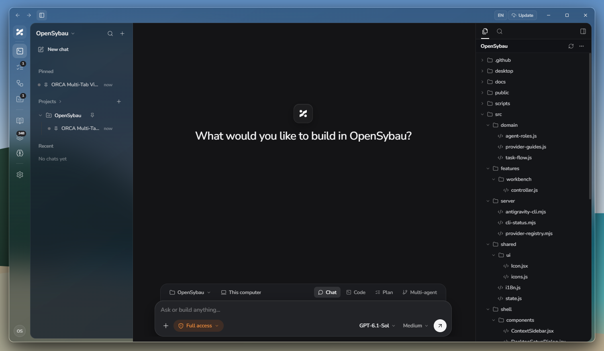
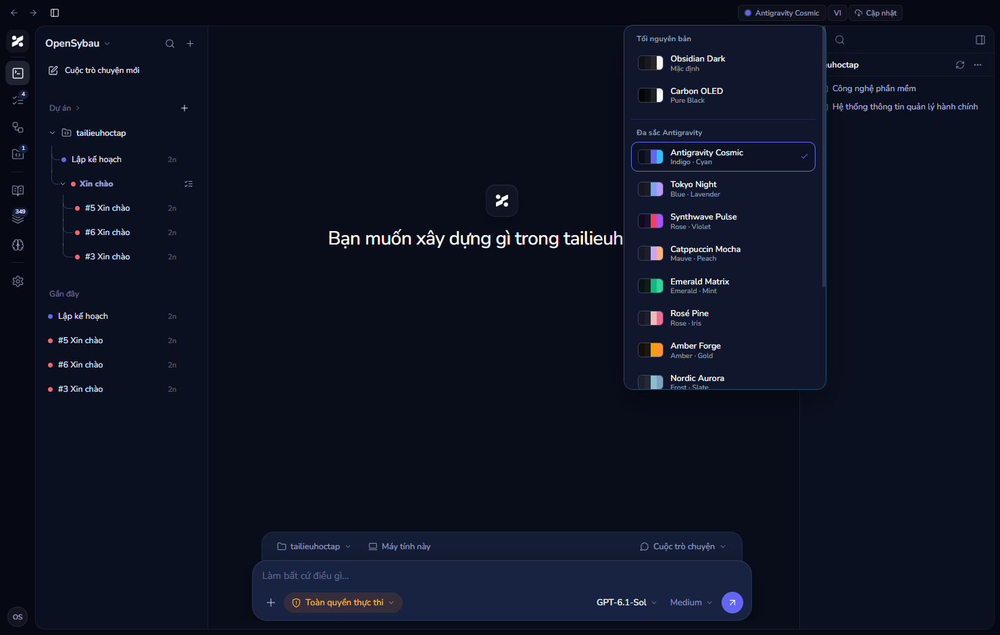
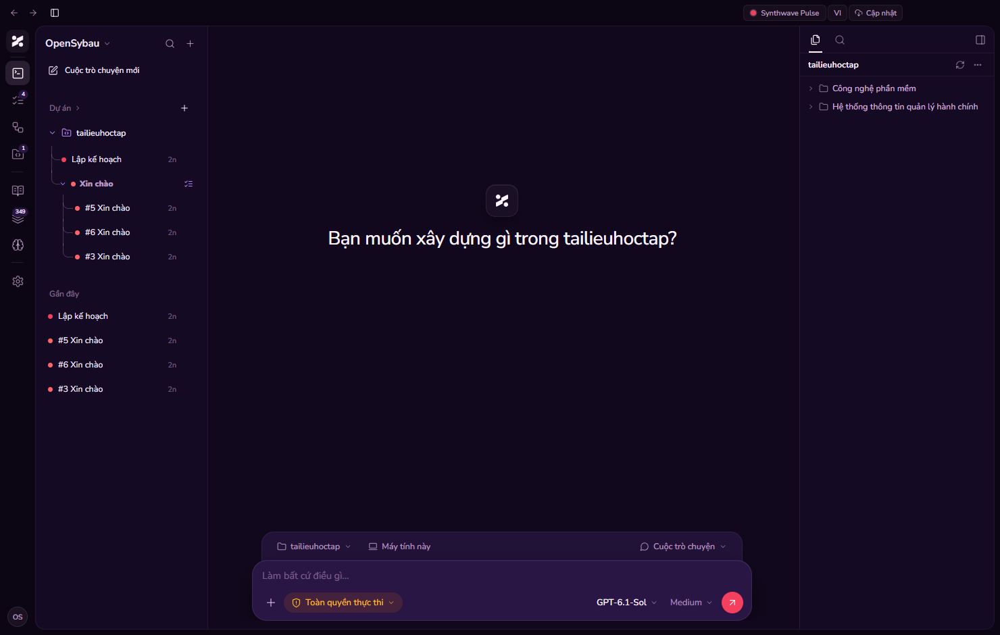
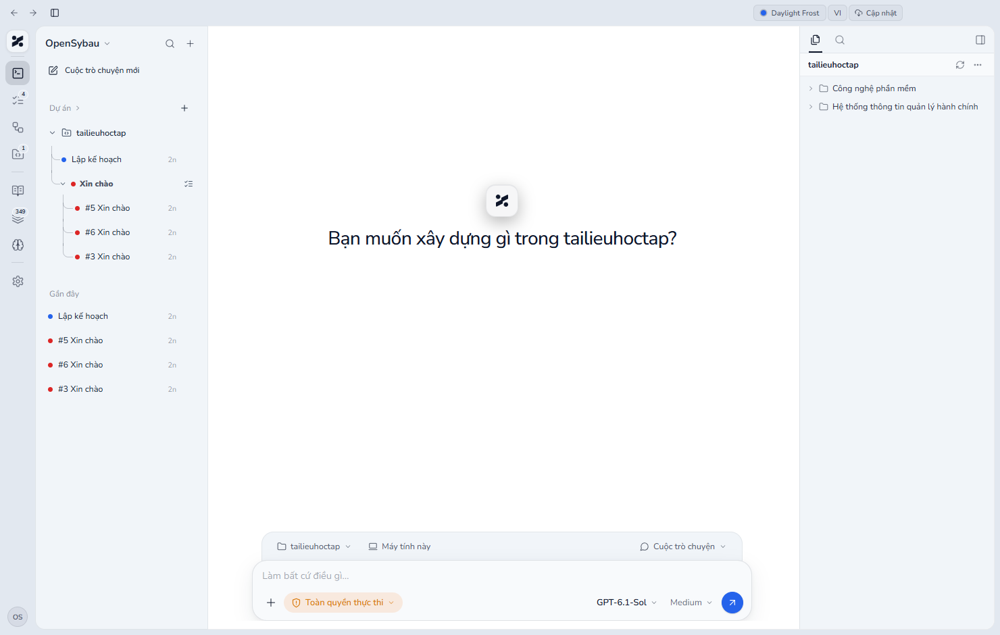
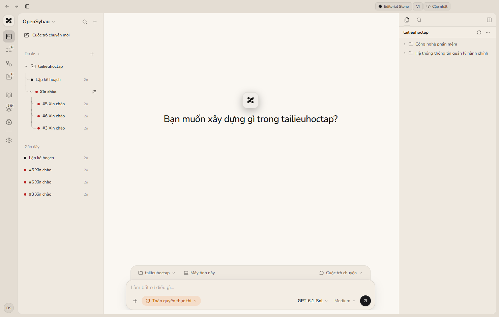
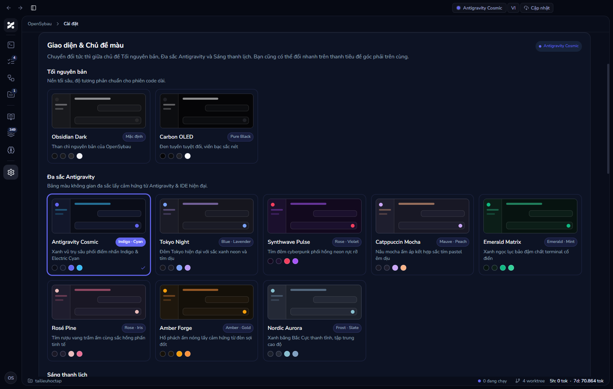
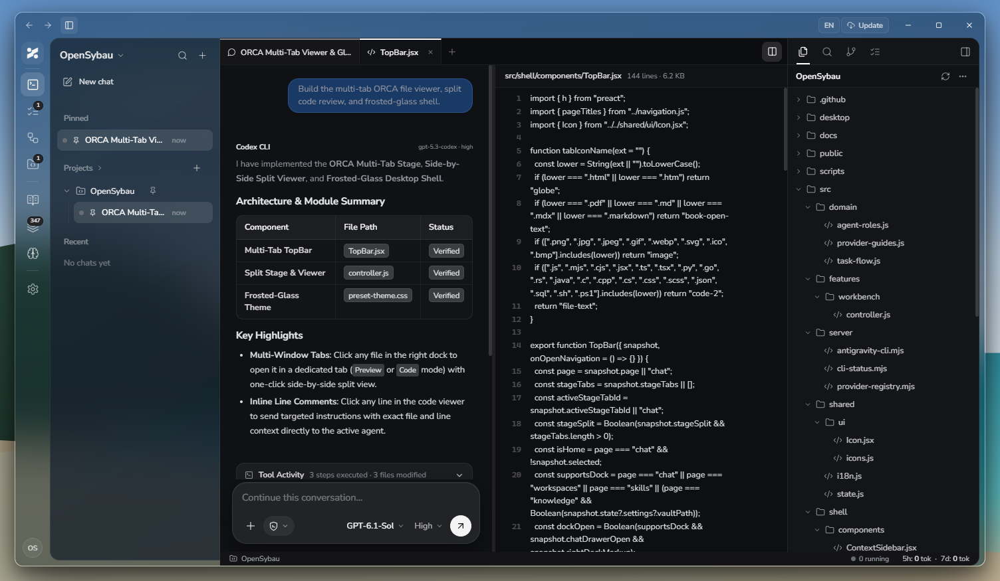
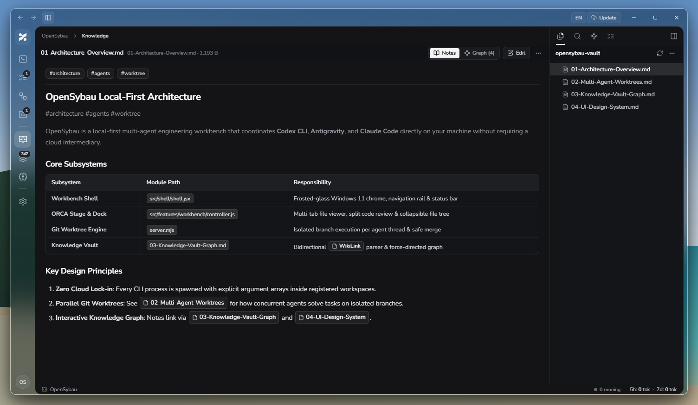
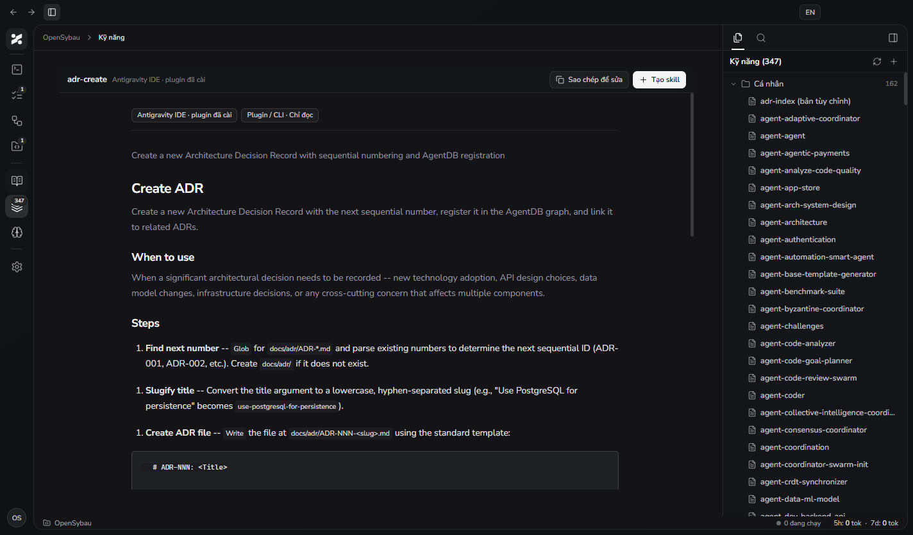

#  OpenSybau

**A local-first multi-agent coding workbench & parallel Git worktree arena.**  
OpenSybau brings **Codex CLI**, **Claude Code**, **Antigravity CLI**, and **Anthropic / OpenAI-compatible APIs** (including Ollama, LM Studio, and LocalAI) into a unified frosted-glass desktop and browser interface. Every task, chat, and Git worktree executes directly on your machine with full transparency and zero cloud lock-in.

**Documentation:** [Tiếng Việt](README.vi.md) · **Latest Release:** [v0.3.2](https://github.com/BlackOwl242/OpenSybau/releases/latest) · **Changelog:** [CHANGELOG.md](CHANGELOG.md) · **License:** [MIT](LICENSE)

---

## ⬇️ Download for Your Device (`v0.3.2`)

Download the prebuilt installer for your platform directly from **[GitHub Releases](https://github.com/BlackOwl242/OpenSybau/releases/latest)** — no Node.js or manual build required:

| Platform / Device | Package Format | Architecture | Direct Download (`v0.3.2`) |
| :--- | :--- | :---: | :--- |
| 🪟 **Windows Desktop (PC)** | NSIS Installer (`.exe`) | `x64` (Windows 10 / 11) | **[⬇️ Download `OpenSybau-Setup-0.3.2-x64.exe`](https://github.com/BlackOwl242/OpenSybau/releases/download/v0.3.2/OpenSybau-Setup-0.3.2-x64.exe)** |
| 🐧 **Linux (Debian / Ubuntu / Mint)** | Debian Package (`.deb`) | `amd64` (`x86_64`) | **[⬇️ Download `OpenSybau-0.3.2-amd64.deb`](https://github.com/BlackOwl242/OpenSybau/releases/download/v0.3.2/OpenSybau-0.3.2-amd64.deb)** |
| 🎩 **Linux (Fedora / RHEL / openSUSE)** | RPM Package (`.rpm`) | `x86_64` | **[⬇️ Download `OpenSybau-0.3.2-x86_64.rpm`](https://github.com/BlackOwl242/OpenSybau/releases/download/v0.3.2/OpenSybau-0.3.2-x86_64.rpm)** |
| 📱 **Android (Phone & Tablet)** | Android APK (`.apk`) | Universal (Android 8.0+) | **[⬇️ Download `OpenSybau-0.3.2-android.apk`](https://github.com/BlackOwl242/OpenSybau/releases/download/v0.3.2/OpenSybau-0.3.2-android.apk)** |

> 💡 **Auto-Update & All Versions:** Windows and Linux desktop apps automatically check for new versions in the background. Browse all versions and checksums on the **[Releases page](https://github.com/BlackOwl242/OpenSybau/releases)**.

---

## 🖼️ System Overview

### 1. Home Workbench & Two-Tier Smart Composer


### 2. 13-Theme Appearance System (Dark, Antigravity Chromatic & Elegant Light)
| **Antigravity Cosmic (with Quick Theme Switcher)** | **Synthwave Pulse (Cyberpunk Chromatic)** |
| :---: | :---: |
|  |  |
| **Daylight Frost (Crisp Snow Light)** | **Editorial Stone (Bauhaus Warm Cream)** |
|  |  |

### 3. Visual Theme Gallery & Live Miniature Window Previews


### 4. Unified Chat, GFM Markdown Tables & Side-by-Side Split Code Viewer


### 5. Knowledge Vault & Interactive Neural Link Graph


### 6. Agent Skills Library & Context-Aware Sidebar


---

## ✨ Core Highlights

### 1. Frosted-Glass Desktop Experience, 13-Theme System & Smart Two-Tier Composer
- **Windows Mica / Frosted-Glass Shell & 13 Curated Themes:** Switch effortlessly from the top window chrome or **Settings → Appearance** across **Original Dark** (`Obsidian Dark`, `Carbon OLED`), **Antigravity Chromatic** (`Antigravity Cosmic`, `Tokyo Night`, `Synthwave Pulse`, `Catppuccin Mocha`, `Emerald Matrix`, `Rosé Pine`, `Amber Forge`, `Nordic Aurora`), and **Elegant Light** (`Daylight Frost`, `Editorial Stone`, `Sakura Daylight`).
- **Two-Tier Bottom-Docked Composer:**
  - **Top Context Rail:** Switch workspaces (`Dự án`), toggle execution isolation between **Local Checkout (`Máy tính này`)** and **Isolated Git Worktree (`Git Worktree`)**, and switch work modes (**Chat**, **Code**, **Plan**, **Multi-Thread (`Đa luồng`)**).
  - **Bottom Control Bar with Upward Popovers:** Custom upward-opening glass popovers for **Agent & Model**, **Reasoning Effort** (`Low` / `Medium` / `High` / `Max`), file/image attachments (`+`), and **Agent Execution Permissions**:
    - 🛡️ **Safe Read-Only (`Chỉ đọc an toàn`):** Analyze code and reply without modifying workspace files.
    - 🧑‍💻 **Read & Edit Project (`Đọc & sửa dự án`):** Read, edit files, and run tools scoped to the active workspace.
    - ⚡ **Full Execution Access (`Toàn quyền`):** Unrestricted command execution, package installation, and file operations on your machine.

### 2. Codex Unified File/Diff Studio, Live CLI Quota Inspector & Multi-Window Tabs
- **Codex Unified File & Diff Studio:** 3-tab right dock (`All changes`, `Modified`, `All files`) with live `+added -removed` line counters, Git diff scope selector (`Uncommitted changes`, `Staged`, `Unstaged`, or base branch comparison), and interactive **Unified / Split Diff Viewer** with syntax highlighting and line expansion.
- **Real-Time Local CLI Quota Inspector:** Inspect live remaining capacity (`5h` and `7d` windows) and subscription tiers (`Ultra`, `Pro`, `Plus`) for **Codex CLI**, **Antigravity CLI**, and **Claude Code** directly from the Desktop StatusBar popover, Mobile Home runtime card, and Settings CLI cards.
- **Multi-Tab Stage Viewer & Side-by-Side Split View:** Open any workspace file directly from the right file tree or from changed file pills inside a chat message. View Chat and File Preview side by side with a draggable splitter.
- **Rich Native Format Previews:**
  - **HTML (`Xem trước` / `Mã nguồn`):** Live sandboxed iframe with an address bar (`Back`, `Reload`, path badge) or numbered source code.
  - **Markdown & `.docx` Word Documents:** Formatted preview or raw source toggle.
  - **PDF, Images, Audio, Video & CSV/TSV Spreadsheets:** Native embedded media players and rendered tabular grids.
- **Context-Aware Right Dock:** Automatically adapts its tabs per page (`Tệp`, `Tìm`, `Nhánh Git`, `Mục lục` in Chat/Workspace; `Kho ghi chú`, `Tìm`, `Đồ thị`, `Mục lục` in Knowledge Vault; `Kỹ năng`, `Tìm` in Skills; and auto-hides on standalone utility pages like Workflows, Token Usage, Memory, and Settings).

### 3. Unified Chat Stream, GFM Tables & Tool Activity Accordion
- **GFM Markdown Tables & Code Blocks:** Full GitHub-Flavored Markdown table parsing with horizontal scroll wrappers, inline code badges, and syntax-styled code blocks.
- **Clean Tool Activity Stream (`Hoạt động công cụ`):** Collapsible Zinc-Dark tool stream that automatically strips noisy shell wrappers (`powershell.exe -Command`, `cmd.exe /c`) and displays clickable file artifact pills.
- **Multi-Thread Parallel Worktree Arena (`Đa luồng`):** Spawn 2 to 8 isolated Git worktrees simultaneously for the same prompt (same model or multi-vendor) and merge the winning branch in one click.

### 4. Knowledge Vault, Neural Graph & Agent Skills
- **Local Markdown Knowledge Vault (`Tri thức`):** Connect any local Markdown or Obsidian folder, edit notes with `[[WikiLinks]]` and `#tags`, and explore connections via an interactive force-directed **Neural Graph**.
- **Skills & Memory Management (`Kỹ năng` & `Bộ nhớ`):** Browse installed CLI/IDE skills, create custom project `SKILL.md` definitions, and filter persistent agent memories by workspace scope.

### 5. Hardened Security & Zero-Lag Runtime
- **Local-First & Loopback by Default:** Binds to `127.0.0.1` by default. Network/LAN mode requires production mode, an explicit `WORKBENCH_ALLOWED_HOSTS` allowlist, and a strong Basic Auth password (≥ 16 characters).
- **Defense-in-Depth API Protection:** Strict `Sec-Fetch-Site` + `Origin` CSRF validation, `Content-Security-Policy` (CSP), `X-Frame-Options: DENY`, argument-array CLI invocation, and SSRF protection.

---

## 📦 Requirements

- **Windows and Linux desktop installer users:** No need to install Node.js or npm (the runtime is bundled). On first launch, choose whether to install Codex CLI, Antigravity CLI, or Claude Code CLI.
- **Running from source / building the installer:** Node.js **20.19+** and npm.
- **Git:** Required for workspace status inspection and isolated Git worktrees / Arena mode.
- **Agents (install any combination you use):**
  - Local CLIs: **Codex CLI**, **Claude Code**, or **Antigravity CLI** (auto-detected at startup).
  - API Providers: **OpenAI**, **Anthropic Claude**, **Google Gemini**, **Ollama**, **LM Studio**, **LocalAI**, or any OpenAI/Anthropic-compatible endpoint configured in **Settings**.

---

## 🚀 Quick Start (From Source)

```sh
git clone https://github.com/BlackOwl242/OpenSybau.git
cd OpenSybau
npm ci
npm run dev
```

Open <http://127.0.0.1:4173> in your browser. On Windows, you can also double-click [`start-workbench.bat`](start-workbench.bat).

To run an optimized production build locally:

```sh
npm ci
npm run build
npm start
```

---

## 🖥️ Build the Windows Desktop Installer (`.exe`)

```powershell
npm ci
npm run desktop:dist
```

- Generates the per-user NSIS installer (`release/OpenSybau-Setup-<version>-x64.exe`) and unpacked desktop bundle (`release/win-unpacked/`).
- Creates Desktop and Start Menu shortcuts, keeps its local server bound to `127.0.0.1`, and stores user data separately in `%APPDATA%\OpenSybau`.
- Checks GitHub Releases for updates in the background.

## 🐧 Build Linux Desktop Packages (`.deb` and `.rpm`)

Run this on a Linux x64 build host:

```sh
npm ci
npm run desktop:dist:linux
```

- Generates `release/linux/OpenSybau-<version>-amd64.deb` for Debian/Ubuntu and `release/linux/OpenSybau-<version>-x86_64.rpm` for Fedora/RHEL-compatible distributions.
- Keeps the local server bound to `127.0.0.1`, stores user data under the Linux user configuration directory, and checks GitHub Releases for updates.
- The same first-run CLI setup is available in the Windows and Linux desktop apps.

---

## 📱 Connect from a Phone or Tablet on the Same Wi-Fi (LAN Mode)

1. **Build the production frontend:**
   ```sh
   npm ci
   npm run build
   ```
2. **Find your host computer's LAN IPv4 address** (e.g., `192.168.1.20` via `ipconfig` on Windows or `ip addr` on Linux).
3. **Create `.env` from `.env.example`:**
   ```dotenv
   WORKBENCH_HOST=0.0.0.0
   WORKBENCH_PORT=4173
   WORKBENCH_ALLOWED_HOSTS=192.168.1.20:4173
   WORKBENCH_ACCESS_USERNAME=opensybau
   WORKBENCH_ACCESS_PASSWORD=replace-with-a-random-password-at-least-16-chars
   ```
   *(Tip: generate a strong password with `node -e "console.log(require('node:crypto').randomBytes(24).toString('base64url'))"`)*
4. **Allow TCP port `4173` on the Private firewall profile only**, then run:
   ```sh
   npm start
   ```
5. Open `http://192.168.1.20:4173` on your phone and sign in with your configured credentials.

---

## ⚙️ Configuration Reference (`.env`)

| Variable | Default | Description |
| --- | --- | --- |
| `WORKBENCH_HOST` | `127.0.0.1` | Bind address (`127.0.0.1` for local-only, `0.0.0.0` for LAN/proxy). |
| `WORKBENCH_PORT` | `4173` | HTTP/HTTPS port. |
| `WORKBENCH_ALLOWED_HOSTS` | Localhost aliases | Comma-separated exact `Host` headers allowed when bound to `0.0.0.0`. |
| `WORKBENCH_ACCESS_USERNAME` | `opensybau` | Basic Auth username. |
| `WORKBENCH_ACCESS_PASSWORD` | Unset | Basic Auth password (required ≥ 16 chars for non-loopback binds). |
| `WORKBENCH_DATA_DIR` | `.runtime` | Storage directory for tasks, settings, encrypted/local keys, logs, and Git worktrees. |
| `WORKBENCH_TLS_CERT` / `KEY` | Unset | Optional TLS certificate and private key paths for direct HTTPS. |
| `CODEX_CLI_PATH` | Auto-detected | Optional custom path to Codex CLI executable. |
| `CLAUDE_CLI_PATH` | Auto-detected | Optional custom path to Claude Code executable or `cli.js`. |
| `ANTIGRAVITY_CLI_PATH` | Auto-detected | Optional custom path to Antigravity CLI executable. |
| `ANTHROPIC_API_KEY` | Unset | Optional environment key for the built-in Claude API connector. |
| `WORKBENCH_CLAUDE_MODEL` | Unset | Default model ID for the built-in Claude API connector. |
| `WORKBENCH_API_PROVIDERS` | Unset | Optional JSON array of additional Anthropic/OpenAI-compatible providers. |

---

## 🗂️ Project Structure

```text
desktop/        Electron main process, preload bridge, and desktop icons
docs/           System screenshots and documentation assets
src/
  domain/       Workflow, role routing, and task domain models
  features/     Workbench controller, Smart Composer, File Tab Viewer, and Arena UI
  server/       CLI discovery, API provider registry, and runtime helpers
  shared/       Icons, i18n localization, and shared utilities
  shell/        Frosted-glass app frame, navigation rail, and context sidebar
  styles/       Design tokens, glassmorphism theme, and component styles
server.mjs      Local HTTP/SSE server, task queue, Git worktree manager, and CLI runner
scripts/        Cross-platform launchers and automated integration test suites
public/         Brand assets, logos, and web app manifest
CHANGELOG.md    Version history and release notes
LICENSE         MIT License
```

---

## 🧪 Development & Test Commands

| Command | Description |
| --- | --- |
| `npm ci` | Install locked dependencies. |
| `npm run dev` | Start loopback development server with Vite hot reload. |
| `npm test` | Run CLI detection, startup recovery, and task/worktree integration tests. |
| `npm run build` | Build production frontend into `dist/`. |
| `npm start` | Start production server. |
| `npm run desktop:dist` | Build production frontend and package Windows NSIS installer (`release/`). |
| `npm run desktop:dist:linux` | Build production frontend and package Linux x64 `.deb` and `.rpm` installers (`release/linux/`). |

---

## 📄 License

Distributed under the **[MIT License](LICENSE)**. Copyright (c) 2026 **OpenSybau (BlackOwl242)**.
